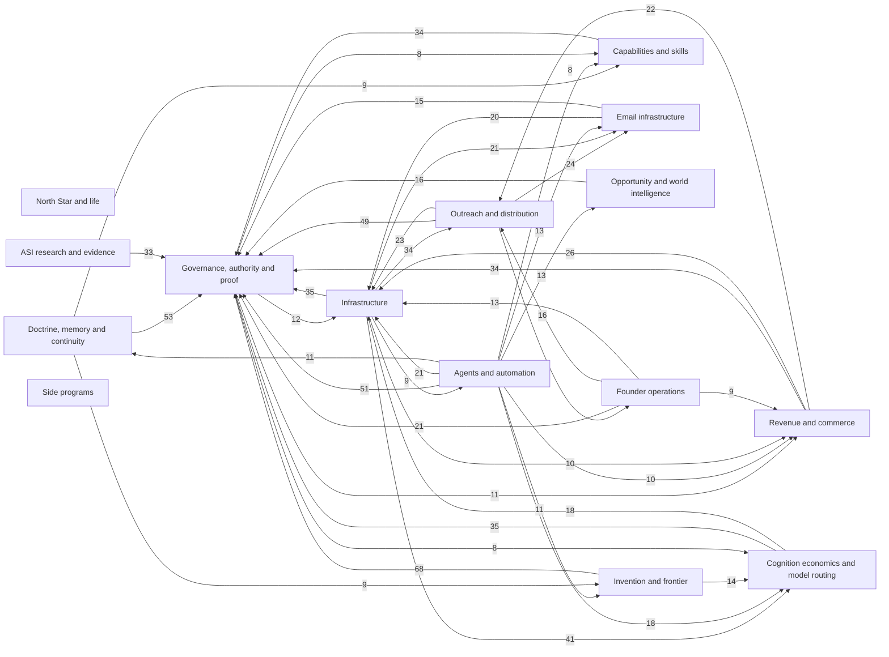

<!-- GENERATED by scripts/repository-index.mjs — do not edit by hand; run `npm run repo:index`. -->

# UberBond atlas — the whole system in one page

> Navigation aid, not evidence. A listed file exists; that says nothing about whether it runs, is deployed, or has produced any external result.

This page is the model of the repository: what each of the 76 projects is, what it is for, how the projects depend on each other, how much of each is wired to a running entry point, and when each was active. It is built from 3435 per-file content judgements, the import graph and dated filenames. Open a project's own page for its files, or the [specialized indexes](../index/specialized/README.md) to look up a function, route, variable, table, job, founder idea or concept.

## 1. The shape of the whole

UberBond is one organism in five bands. **Direction**: the North Star family says what the system is for and who decides. **Memory**: doctrine, handoffs and PHOENIX carry context between sessions. **Cognition**: invention, evaluation and model-routing projects produce and test ideas and decide how much model spend a task gets. **Action**: agents, capabilities, outreach, email infrastructure and revenue projects act in the world. **Ground**: governance, stores and deployment make every action counted, permitted and durable. Authority flows down from the founder; evidence flows up from reality.

Across all projects there are **1145 source modules: 393 reachable from the server/worker, 218 only from CLI commands, and 534 from no entry point.** The last group is real code, usually with tests, that no server, worker, API route or npm command statically imports. Some may still be loaded dynamically, so treat it as a list to verify, not a verdict.

## 2. How the families depend on each other

Arrows read "builds on". Edge labels count imports between modules of different families; only links of 8 or more are drawn.

## 3. Foundations: what the most other projects rely on

| Project | Relied on by (projects) | Incoming imports |
|---|---:|---:|
| [Consent, authority, proof and effect ledgers](authority-evidence.md) | 55 | 401 |
| [Server core, shared utilities and test harness](core-platform.md) | 28 | 77 |
| [Outreach (umbrella)](outreach.md) | 17 | 43 |
| [Postgres, stores and migrations](data-stores.md) | 16 | 45 |
| [OMNIA](omnia.md) | 12 | 47 |
| [Capability Genome](capability-genome.md) | 12 | 27 |
| [Revenue and payments (umbrella)](revenue-payments.md) | 12 | 24 |
| [Sovereign Cognitive Continuum](sovereign-continuum.md) | 12 | 15 |
| [Agent mesh and autonomy loop](agent-mesh.md) | 11 | 32 |
| [Brain, Total Brain and Master Memory](brain-memory.md) | 11 | 25 |
| [Infinite Opus and Frontier-Max](infinite-opus.md) | 10 | 43 |
| [Cognition ledger and economics](cognition-ledger.md) | 10 | 37 |

## 4. Wiring: built versus connected

Projects with source modules, ordered by the share reachable from the server/worker. A low share means the code exists and is tested but no running entry point statically imports it.

| Project | Modules | Server/worker | CLI only | Unconnected | Tests |
|---|---:|---:|---:|---:|---:|
| [Prometheus](prometheus.md) | 10 | 10 | 0 | 0 | 25 |
| [Uber Socket](uber-socket.md) | 9 | 9 | 0 | 0 | 7 |
| [Revenue Singularity, Constellation and G-SPOT](revenue-constellation.md) | 9 | 9 | 0 | 0 | 14 |
| [Claude, ChatGPT and assistant integrations](assistant-integrations.md) | 1 | 1 | 0 | 0 | 13 |
| [Client engagements (Powerhouse, Contra, Halfteck)](client-engagements.md) | 1 | 1 | 0 | 0 | 4 |
| [Winnr](winnr.md) | 14 | 13 | 0 | 1 | 31 |
| [Crown](crown.md) | 13 | 12 | 0 | 1 | 36 |
| [Server core, shared utilities and test harness](core-platform.md) | 10 | 9 | 0 | 1 | 95 |
| [First cash and first customer](first-cash.md) | 7 | 6 | 1 | 0 | 23 |
| [Outreach (umbrella)](outreach.md) | 40 | 30 | 4 | 6 | 123 |
| [Prospecting and lead generation](prospecting-leadgen.md) | 40 | 27 | 0 | 13 | 69 |
| [Revenue and payments (umbrella)](revenue-payments.md) | 24 | 16 | 0 | 8 | 63 |
| [Infinite Opus and Frontier-Max](infinite-opus.md) | 31 | 20 | 2 | 9 | 85 |
| [Inquiry-path audits and verified defects](inquiry-audit-product.md) | 11 | 7 | 3 | 1 | 28 |
| [DNS, domains and fleet](dns-domains.md) | 19 | 12 | 2 | 5 | 43 |
| [Cognition ledger and economics](cognition-ledger.md) | 13 | 8 | 3 | 2 | 56 |
| [Global green lane and free routing](green-lane.md) | 13 | 8 | 0 | 5 | 28 |
| [Jev and UberLit](jev-uberlit.md) | 17 | 10 | 4 | 3 | 41 |
| [UberMail and UberDoso](ubermail-uberdoso.md) | 17 | 10 | 2 | 5 | 38 |
| [UberReply, replies and async closing](reply-closing.md) | 12 | 7 | 1 | 4 | 29 |
| [Sovereign Cognitive Continuum](sovereign-continuum.md) | 22 | 12 | 7 | 3 | 56 |
| [Command center and founder console](command-center.md) | 13 | 6 | 3 | 4 | 37 |
| [OpenRouter and Open Model Universe](model-routing.md) | 22 | 10 | 6 | 6 | 82 |
| [Opportunity factory, Event Horizon and World Brain](opportunity-factory.md) | 11 | 5 | 2 | 4 | 26 |
| [Economic reliability and wealth engines](economic-engines.md) | 29 | 13 | 1 | 15 | 41 |
| [Sovereign Option and Outcome Forecast Engine](forecast-engine.md) | 9 | 4 | 0 | 5 | 29 |
| [Inboxes, placement and reputation](inboxes-placement.md) | 15 | 6 | 0 | 9 | 40 |
| [Offers, services and fulfilment](offers-fulfilment.md) | 13 | 5 | 0 | 8 | 27 |
| [UberReach, UberOutbound and UberLaunch](uberreach-uberoutbound.md) | 14 | 5 | 1 | 8 | 42 |
| [Consent, authority, proof and effect ledgers](authority-evidence.md) | 15 | 5 | 3 | 7 | 105 |
| [OMNIA](omnia.md) | 52 | 16 | 3 | 33 | 60 |
| [Personal Civilization Engine](personal-civilization.md) | 27 | 8 | 6 | 13 | 41 |
| [Platform deployment and providers](platform-deploy.md) | 7 | 2 | 0 | 5 | 41 |
| [Agent mesh and autonomy loop](agent-mesh.md) | 40 | 11 | 17 | 12 | 164 |
| [AI employees and Avengers](ai-employees.md) | 11 | 3 | 8 | 0 | 28 |
| [Postgres, stores and migrations](data-stores.md) | 11 | 3 | 3 | 5 | 110 |
| [Relays (ChatGPT, Claude, cloud, GitHub)](relay.md) | 15 | 4 | 3 | 8 | 43 |
| [Distribution OS and channels](distribution-os.md) | 15 | 4 | 0 | 11 | 17 |
| [Wallbreaker](wallbreaker.md) | 4 | 1 | 2 | 1 | 11 |
| [UberMind](ubermind.md) | 21 | 5 | 0 | 16 | 34 |
| [Semantic closure and execution-leaf kernel](semantic-closure.md) | 26 | 6 | 4 | 16 | 63 |
| [Readiness, reachability and coverage audits](readiness-audits.md) | 14 | 3 | 3 | 8 | 82 |
| [APOTHEOSIS and orchestration checkpoints](apotheosis-orchestration.md) | 5 | 1 | 0 | 4 | 9 |
| [Frontier intelligence runtime](frontier.md) | 31 | 6 | 6 | 19 | 46 |
| [Capability Genome](capability-genome.md) | 27 | 5 | 14 | 8 | 49 |
| [UberWarm and UberWarm2](uberwarm.md) | 38 | 7 | 0 | 31 | 49 |
| [Gamechanger mesh and frontier sensing](gamechanger.md) | 11 | 2 | 3 | 6 | 26 |
| [Brain, Total Brain and Master Memory](brain-memory.md) | 24 | 3 | 7 | 14 | 69 |
| [Neural Exocortex and Connectome](neural-exocortex.md) | 8 | 1 | 0 | 7 | 14 |
| [PHOENIX](phoenix.md) | 17 | 2 | 4 | 11 | 45 |
| [Self-maintainer, constitution and recursive governance](self-maintainer.md) | 20 | 2 | 4 | 14 | 84 |
| [NULLSTAR Omega](nullstar.md) | 26 | 2 | 24 | 0 | 29 |
| [GENESIS, GENESIS2 and Ontogenesis](genesis.md) | 43 | 0 | 28 | 15 | 61 |
| [Omega private-evidence lab and canaries](omega-lab.md) | 35 | 0 | 1 | 34 | 30 |
| [Skills, plugins and Task Observer](skills-plugins.md) | 28 | 0 | 2 | 26 | 36 |
| [Night Shift, Nightfall and overnight lanes](night.md) | 17 | 0 | 4 | 13 | 16 |
| [Founder 890 moonshots](moonshot-890.md) | 16 | 0 | 6 | 10 | 26 |
| [UberCel, UberCloud and UberOcean](ubercel-cloud.md) | 15 | 0 | 4 | 11 | 22 |
| [Sovereign self-host stack](sovereign-selfhost.md) | 11 | 0 | 3 | 8 | 58 |
| [Million-branch ideation and Wormhole](million-wormhole.md) | 8 | 0 | 3 | 5 | 13 |
| [Kilimanjaro and founder absence](kilimanjaro.md) | 8 | 0 | 5 | 3 | 31 |
| [C21 and ASI evidence tribunals](c21-asi-evidence.md) | 7 | 0 | 0 | 7 | 23 |
| [Sandwich Method](sandwich-method.md) | 6 | 0 | 0 | 6 | 13 |
| [Reasoning architecture and evaluation](reasoning-lab.md) | 6 | 0 | 1 | 5 | 15 |
| [UBER/OS](uberos.md) | 6 | 0 | 0 | 6 | 1 |
| [Quant research lab](quant-lab.md) | 5 | 0 | 0 | 5 | 2 |
| [Temporal Foundry and timeline topology](temporal-foundry.md) | 4 | 0 | 0 | 4 | 4 |
| [APEX campaigns](apex.md) | 4 | 0 | 4 | 0 | 15 |
| [Wessam Singularity](wessam-singularity.md) | 1 | 0 | 1 | 0 | 1 |
| [UberWatt and energy-compute mesh](uberwatt.md) | 1 | 0 | 0 | 1 | 3 |

## 5. Timeline: when each project was active

Count of dated files per month (dates come from filenames). Blank means no dated file that month.

| Project | 26-08 | 26-09 | 26-10 |
|---|---:|---:|---:|
| [Distribution OS and channels](distribution-os.md) | 13 | 2 |  |
| [Outreach (umbrella)](outreach.md) | 7 | 29 | 65 |
| [UberReach, UberOutbound and UberLaunch](uberreach-uberoutbound.md) | 2 | 15 | 2 |
| [First cash and first customer](first-cash.md) | 3 | 17 | 15 |
| [Inquiry-path audits and verified defects](inquiry-audit-product.md) | 3 |  | 5 |
| [Offers, services and fulfilment](offers-fulfilment.md) | 6 | 2 | 6 |
| [Prospecting and lead generation](prospecting-leadgen.md) | 10 | 4 | 19 |
| [Agent mesh and autonomy loop](agent-mesh.md) | 6 | 2 | 3 |
| [Consent, authority, proof and effect ledgers](authority-evidence.md) | 1 | 1 | 16 |
| [Handoffs and checkpoints](handoffs-checkpoints.md) | 8 | 40 | 19 |
| [Everest, SUMMIT 100, BLACK SKY, Ragnarok lineage](historical-lineage.md) | 3 | 5 |  |
| [OMNIA](omnia.md) | 1 |  |  |
| [Opportunity factory, Event Horizon and World Brain](opportunity-factory.md) | 10 |  |  |
| [Relays (ChatGPT, Claude, cloud, GitHub)](relay.md) | 5 |  | 1 |
| [Self-maintainer, constitution and recursive governance](self-maintainer.md) | 1 | 4 | 1 |
| [Kilimanjaro and founder absence](kilimanjaro.md) | 10 | 2 |  |
| [Prometheus](prometheus.md) | 1 |  |  |
| [Readiness, reachability and coverage audits](readiness-audits.md) | 3 | 29 | 9 |
| [Work, Astra and Sol sessions](work-astra-sol.md) | 7 | 12 | 13 |
| [Night Shift, Nightfall and overnight lanes](night.md) | 13 | 54 |  |
| [Capability Genome](capability-genome.md) | 6 | 16 | 11 |
| [Revenue and payments (umbrella)](revenue-payments.md) | 4 | 16 | 8 |
| [Skills, plugins and Task Observer](skills-plugins.md) | 4 | 2 | 1 |
| [AI employees and Avengers](ai-employees.md) | 1 | 4 |  |
| [Claude, ChatGPT and assistant integrations](assistant-integrations.md) | 4 | 5 | 9 |
| [Brain, Total Brain and Master Memory](brain-memory.md) | 2 | 8 | 4 |
| [Cash Engine Lite](lite-cash-engine.md) | 1 |  |  |
| [Platform deployment and providers](platform-deploy.md) | 1 | 11 | 14 |
| [Economic reliability and wealth engines](economic-engines.md) | 1 | 2 | 3 |
| [OpenRouter and Open Model Universe](model-routing.md) | 1 | 38 | 5 |
| [Global green lane and free routing](green-lane.md) |  | 1 | 13 |
| [UberReply, replies and async closing](reply-closing.md) |  | 5 | 7 |
| [UberMind](ubermind.md) |  | 3 | 48 |
| [Frontier intelligence runtime](frontier.md) |  | 13 |  |
| [Gamechanger mesh and frontier sensing](gamechanger.md) |  | 2 |  |
| [GENESIS, GENESIS2 and Ontogenesis](genesis.md) |  | 26 | 2 |
| [APOTHEOSIS and orchestration checkpoints](apotheosis-orchestration.md) |  | 9 |  |
| [Cognition ledger and economics](cognition-ledger.md) |  | 16 | 18 |
| [Command center and founder console](command-center.md) |  | 7 | 2 |
| [Postgres, stores and migrations](data-stores.md) |  | 3 | 17 |
| [Neural Exocortex and Connectome](neural-exocortex.md) |  | 2 |  |
| [Sovereign Cognitive Continuum](sovereign-continuum.md) |  | 3 |  |
| [C21 and ASI evidence tribunals](c21-asi-evidence.md) |  | 8 |  |
| [Semantic closure and execution-leaf kernel](semantic-closure.md) |  | 5 | 1 |
| [Revenue Singularity, Constellation and G-SPOT](revenue-constellation.md) |  | 5 | 15 |
| [DNS, domains and fleet](dns-domains.md) |  | 7 | 4 |
| [Inboxes, placement and reputation](inboxes-placement.md) |  | 4 | 10 |
| [NULLSTAR Omega](nullstar.md) |  | 2 |  |
| [Reasoning architecture and evaluation](reasoning-lab.md) |  | 7 | 2 |
| [Sovereign self-host stack](sovereign-selfhost.md) |  | 2 |  |
| [Jev and UberLit](jev-uberlit.md) |  | 18 | 17 |
| [Million-branch ideation and Wormhole](million-wormhole.md) |  | 2 |  |
| [Omega private-evidence lab and canaries](omega-lab.md) |  | 74 |  |
| [Personal Civilization Engine](personal-civilization.md) |  | 1 |  |
| [UberMail and UberDoso](ubermail-uberdoso.md) |  | 5 |  |
| [UberCel, UberCloud and UberOcean](ubercel-cloud.md) |  | 4 |  |
| [Founder 890 moonshots](moonshot-890.md) |  | 47 | 5 |
| [Temporal Foundry and timeline topology](temporal-foundry.md) |  | 1 |  |
| [UberWatt and energy-compute mesh](uberwatt.md) |  | 2 |  |
| [Wallbreaker](wallbreaker.md) |  | 1 |  |
| [UberWarm and UberWarm2](uberwarm.md) |  | 1 | 37 |
| [APEX campaigns](apex.md) |  | 8 |  |
| [Crown](crown.md) |  | 17 | 9 |
| [Infinite Opus and Frontier-Max](infinite-opus.md) |  | 84 | 26 |
| [Wessam Singularity](wessam-singularity.md) |  | 2 |  |
| [Server core, shared utilities and test harness](core-platform.md) |  | 2 | 2 |
| [Winnr](winnr.md) |  |  | 32 |
| [Client engagements (Powerhouse, Contra, Halfteck)](client-engagements.md) |  |  | 25 |
| [PHOENIX](phoenix.md) |  |  | 40 |
| [Quant research lab](quant-lab.md) |  |  | 1 |

## 6. Every project, explained

### 1. North Star and life

#### [Wessam Singularity](wessam-singularity.md)

The top of the hierarchy: a founder-level research program asking whether the machinery that produces your future selves and options can undergo a real regime change. It is defined as falsifiable, with a continuity module that packs your cognitive state into portable recovery capsules.

**Used for:** Orienting everything beneath it, and carrying founder continuity across providers. It is a target, never a claimed result.

_6 files · 1 source modules: 0 reachable from the server/worker, 1 only from CLI commands, 0 from no entry point. 1 tests · active 2026-09 · builds on: Consent, authority, proof and effect ledgers · relied on by: Readiness, reachability and coverage audits_

#### [Sovereign Cognitive Continuum](sovereign-continuum.md)

UberBond's terminal identity: you supply will, the system supplies intelligence, reality supplies feedback. The code here is the guard layer around that relation: a living model of you that refuses to freeze your identity, privacy views over your context, typed ignorance and bias attacks on conclusions, and an intent compiler that traces a choice through permissions to observed consequences.

**Used for:** Keeping any amount of intelligence from turning into authority over what you want; the constitution every session reads first.

_138 files · 22 source modules: 12 reachable from the server/worker, 7 only from CLI commands, 3 from no entry point. 56 tests · active 2026-09 · builds on: Personal Civilization Engine, Consent, authority, proof and effect ledgers, Sovereign Option and Outcome Forecast Engine, Agent mesh and autonomy loop, Brain, Total Brain and Master Memory · relied on by: Agent mesh and autonomy loop, Personal Civilization Engine, Reasoning architecture and evaluation, Brain, Total Brain and Master Memory, Sovereign Option and Outcome Forecast Engine_

#### [Personal Civilization Engine](personal-civilization.md)

The life-system layer. A private life record with provable export and deletion, a provenance-carrying life knowledge graph, an options scorer that compares life choices per dimension without collapsing them into one number, a futures inventory showing which branches a decision opens or closes, and a human capability graph that searches for your binding bottleneck.

**Used for:** Seeing your life options, capabilities and consequences clearly while you remain the chooser. About half its modules are not yet wired to any entry point.

_89 files · 27 source modules: 8 reachable from the server/worker, 6 only from CLI commands, 13 from no entry point. 41 tests · active 2026-09 · builds on: Sovereign Option and Outcome Forecast Engine, Consent, authority, proof and effect ledgers, Sovereign Cognitive Continuum, Server core, shared utilities and test harness · relied on by: Sovereign Cognitive Continuum, Agent mesh and autonomy loop, Brain, Total Brain and Master Memory, Founder 890 moonshots, Readiness, reachability and coverage audits_

#### [Sovereign Option and Outcome Forecast Engine](forecast-engine.md)

The decision-science organ: forecast methods that compete on hindcast accuracy, an ensemble that discounts forecasters sharing the same evidence, a sealed calibration ledger that scores forecasts against outcomes and separates forecast accuracy from decision quality, and a value-of-information governor that says when to stop researching.

**Used for:** Getting option sets with honest outcome ranges before a material decision, and learning over time which methods deserve trust.

_64 files · 9 source modules: 4 reachable from the server/worker, 0 only from CLI commands, 5 from no entry point. 29 tests · active undated · builds on: Sovereign Cognitive Continuum · relied on by: Personal Civilization Engine, Sovereign Cognitive Continuum, Readiness, reachability and coverage audits, Self-maintainer, constitution and recursive governance, GENESIS, GENESIS2 and Ontogenesis_

### 2. Doctrine, memory and continuity

#### [UberMind](ubermind.md)

The cognition doctrine and its economics. Doctrine: constitutions V4 to V10, the Omega46-52 lens cards, the founder 52 concepts and the grand library. Code: cost models for model mixes and agent meshes, a topology chooser that sizes cognition to consequence and reversibility, and exact source-work accounting.

**Used for:** Telling every assistant how to think and report (the receipts), and deciding how much model spend a task deserves. Mostly doctrine; most of its modules are not wired.

_199 files · 21 source modules: 5 reachable from the server/worker, 0 only from CLI commands, 16 from no entry point. 34 tests · active 2026-09 to 2026-10 · builds on: Infinite Opus and Frontier-Max, Consent, authority, proof and effect ledgers, Server core, shared utilities and test harness, Frontier intelligence runtime · relied on by: Server core, shared utilities and test harness, Infinite Opus and Frontier-Max, Readiness, reachability and coverage audits, Uber Socket_

#### [PHOENIX](phoenix.md)

Context survival. A context journal with projections, task bindings and schema versioning, so each task gets only its bound slice of context and a brain state can be carried as a capsule with integrity and freshness. Around it: the PHOENIX protocol, an MCP connector with eight tools, 15 deterministic zero-effect handlers and capability waves 3 to 10.

**Used for:** Resuming in a new chat without retelling the project. The October 24 checkpoint records MCP tests passing and ChatGPT registration unverified.

_165 files · 17 source modules: 2 reachable from the server/worker, 4 only from CLI commands, 11 from no entry point. 45 tests · active 2026-10 · builds on: Consent, authority, proof and effect ledgers, Brain, Total Brain and Master Memory, Capability Genome, GENESIS, GENESIS2 and Ontogenesis, OMNIA · relied on by: Brain, Total Brain and Master Memory, Agent mesh and autonomy loop, Server core, shared utilities and test harness, Sovereign Cognitive Continuum, APOTHEOSIS and orchestration checkpoints_

#### [Brain, Total Brain and Master Memory](brain-memory.md)

The repository's own memory and self-model: a cognitive graph of organs with typed edges, an event bus and append-only journal over it, a lifetime memory index across episodic, semantic, economic and evidence layers, plus Total Brain and Master Memory as the anti-forgetting canon of programs and lineage.

**Used for:** Reconstructing the whole organism before narrowing to a task; the brain packet you run at startup comes from here.

_228 files · 24 source modules: 3 reachable from the server/worker, 7 only from CLI commands, 14 from no entry point. 69 tests · active 2026-08 to 2026-10 · builds on: Consent, authority, proof and effect ledgers, PHOENIX, GENESIS, GENESIS2 and Ontogenesis, Opportunity factory, Event Horizon and World Brain, Capability Genome · relied on by: PHOENIX, Readiness, reachability and coverage audits, Uber Socket, Command center and founder console, GENESIS, GENESIS2 and Ontogenesis_

#### [Handoffs and checkpoints](handoffs-checkpoints.md)

The dated trail of where work stopped: the current handoff and system state, per-session handoffs, crash-safe checkpoints and the entry-point files assistants read first. Documents only, no source modules.

**Used for:** Picking up exactly where a previous session left off, and seeing what was true on a given date.

_130 files · No source modules of its own (records and data, no source modules). 11 tests · active 2026-08 to 2026-10_

#### [APOTHEOSIS and orchestration checkpoints](apotheosis-orchestration.md)

Your orchestration specification made executable: packets P00 to P49, a runtime that selects context policy, allocates scarce strong-model reasoning, routes work down to cheaper models and hands off continuity, and a graph validator that tournaments orchestration candidates.

**Used for:** Running large multi-agent builds in dependency order. Gate 4, real closed-loop evidence, is recorded as externally blocked.

_33 files · 5 source modules: 1 reachable from the server/worker, 0 only from CLI commands, 4 from no entry point. 9 tests · active 2026-09 · builds on: Consent, authority, proof and effect ledgers, Sovereign self-host stack, Agent mesh and autonomy loop, PHOENIX, Relays (ChatGPT, Claude, cloud, GitHub) · relied on by: AI employees and Avengers, Frontier intelligence runtime, Skills, plugins and Task Observer_

#### [Everest, SUMMIT 100, BLACK SKY, Ragnarok lineage](historical-lineage.md)

The record of earlier named programs: Everest, SUMMIT 100, BLACK SKY, Reality Activation, Ragnarok, Night War, with their closure receipts and the register of external gates still open.

**Used for:** Not forgetting what older programs donated, and seeing honest closure verdicts such as NIGHT-10 meeting 9 of 11 obligations.

_29 files · No source modules of its own (records and data, no source modules). 3 tests · active 2026-08 to 2026-09_

#### [Work, Astra and Sol sessions](work-astra-sol.md)

The prompts, bootstraps and packet queues that drive GPT Work, Astra and Sol sessions and Claude mega-missions, including the progress baseline and the launch package that splits readiness into purchase, send, collection and delivery.

**Used for:** Starting a working session for another assistant with the right mission and reporting format.

_42 files · No source modules of its own (doctrine and plans, no source modules). 0 tests · active 2026-08 to 2026-10_

### 3. Invention and frontier

#### [GENESIS, GENESIS2 and Ontogenesis](genesis.md)

The invention engine. A mechanism compiler with stable statement identity, idea bursts drawn from the million-branch genome, an ontology and scientist layer, an escalation tribunal that decides implement, escalate or wait for reality, and an evidence ledger showing which of the 275 registry ideas have code behind them.

**Used for:** Generating and testing new mechanisms and ideas nobody asked for, cheaply and without external effects. Reachable from CLI commands, not from the server.

_208 files · 43 source modules: 0 reachable from the server/worker, 28 only from CLI commands, 15 from no entry point. 61 tests · active 2026-09 to 2026-10 · builds on: Consent, authority, proof and effect ledgers, Million-branch ideation and Wormhole, Founder 890 moonshots, Brain, Total Brain and Master Memory, Frontier intelligence runtime · relied on by: Brain, Total Brain and Master Memory, Readiness, reachability and coverage audits, Capability Genome, Gamechanger mesh and frontier sensing, PHOENIX_

#### [Founder 890 moonshots](moonshot-890.md)

Your 890 original ideas as an immutable, hash-verified corpus in ten shards, plus what is compiled from it: a realization state machine, a technology tree, a triage of which moonshots can be realized internally, a substrate mesh and a portfolio ranking of shared ancestor capabilities.

**Used for:** Retrieving any original idea exactly, and choosing which shared building blocks to construct first. Source-complete does not mean realized.

_146 files · 16 source modules: 0 reachable from the server/worker, 6 only from CLI commands, 10 from no entry point. 26 tests · active 2026-09 to 2026-10 · builds on: Consent, authority, proof and effect ledgers, GENESIS, GENESIS2 and Ontogenesis, Sovereign Option and Outcome Forecast Engine, OMNIA, Personal Civilization Engine · relied on by: GENESIS, GENESIS2 and Ontogenesis, Temporal Foundry and timeline topology_

#### [Gamechanger mesh and frontier sensing](gamechanger.md)

Always-on world sensing: a mesh over sixteen domains that canonicalizes, dedupes and scores public signals, paces polling within provider rate limits, and turns discoveries into frontier learning inputs and combinable idea packets.

**Used for:** Noticing early when the outside world changes what is possible for you or the system.

_72 files · 11 source modules: 2 reachable from the server/worker, 3 only from CLI commands, 6 from no entry point. 26 tests · active 2026-09 · builds on: Consent, authority, proof and effect ledgers, GENESIS, GENESIS2 and Ontogenesis, Capability Genome · relied on by: Frontier intelligence runtime, GENESIS, GENESIS2 and Ontogenesis, Readiness, reachability and coverage audits_

#### [Million-branch ideation and Wormhole](million-wormhole.md)

Combinatorial ideation at scale: an index that encodes a million cross-organ candidates, operators that generate them, shard tournaments, and a spec of 20 domains by 50 operators extending the 275-idea registry.

**Used for:** Searching far, low-similarity combinations of existing organs for ideas ordinary brainstorming would miss.

_43 files · 8 source modules: 0 reachable from the server/worker, 3 only from CLI commands, 5 from no entry point. 13 tests · active 2026-09 · builds on: Capability Genome, GENESIS, GENESIS2 and Ontogenesis · relied on by: GENESIS, GENESIS2 and Ontogenesis, Reasoning architecture and evaluation, C21 and ASI evidence tribunals, OMNIA_

#### [Temporal Foundry and timeline topology](temporal-foundry.md)

Reasoning about time order: analyses of future capability states, a timeline topology engine that looks for shortcuts across planned timelines, and an epoch-branching evaluator with ancestor ablation over the 890 technology tree.

**Used for:** Asking which future capability can be pulled forward and which prerequisite actually matters. Source-level only; none of its modules are wired.

_15 files · 4 source modules: 0 reachable from the server/worker, 0 only from CLI commands, 4 from no entry point. 4 tests · active 2026-09 · builds on: Consent, authority, proof and effect ledgers, Founder 890 moonshots · relied on by: Sovereign self-host stack_

#### [Neural Exocortex and Connectome](neural-exocortex.md)

A large external capability memory: a neural capability corpus with priors and merge rules, harvest storage outside working memory, a repository atlas plan, and the Connectome rule that every new feature must join the organ graph through typed edges.

**Used for:** Holding far more capability knowledge than fits in context and finding missing links between modules.

_46 files · 8 source modules: 1 reachable from the server/worker, 0 only from CLI commands, 7 from no entry point. 14 tests · active 2026-09 · builds on: Brain, Total Brain and Master Memory, Capability Genome, Consent, authority, proof and effect ledgers, Frontier intelligence runtime · relied on by: Agent mesh and autonomy loop, Brain, Total Brain and Master Memory_

#### [Sandwich Method](sandwich-method.md)

A work-decomposition method: pair exact current reality with a stronger descendant design, then fold the gap into bounded missions and canonical leaves, with governors for self-continuing tasks and evidence bound to each plan.

**Used for:** Turning a big ambition into small verifiable steps that agents can execute. Not wired to any entry point.

_31 files · 6 source modules: 0 reachable from the server/worker, 0 only from CLI commands, 6 from no entry point. 13 tests · active undated · builds on: Relays (ChatGPT, Claude, cloud, GitHub), Agent mesh and autonomy loop, Readiness, reachability and coverage audits · relied on by: Self-maintainer, constitution and recursive governance, Agent mesh and autonomy loop, Sovereign self-host stack_

#### [Frontier intelligence runtime](frontier.md)

The multi-model reasoning runtime: plans cognition across reasoning tiers with a context spine, proves a frontier model is actually callable before use, admits models only with sealed benchmark evidence, and harvests frontier AI mechanisms from public sources.

**Used for:** Getting frontier-grade answers by composing models instead of trusting one, and absorbing new techniques as they appear.

_117 files · 31 source modules: 6 reachable from the server/worker, 6 only from CLI commands, 19 from no entry point. 46 tests · active 2026-09 · builds on: Consent, authority, proof and effect ledgers, Infinite Opus and Frontier-Max, Server core, shared utilities and test harness, Gamechanger mesh and frontier sensing, OpenRouter and Open Model Universe · relied on by: AI employees and Avengers, Agent mesh and autonomy loop, GENESIS, GENESIS2 and Ontogenesis, Crown, Neural Exocortex and Connectome_

#### [APEX campaigns](apex.md)

The experiment that tests the cost-compression claim: sealed architecture trials with committed digests and NULLSTAR holdouts, identity-blind packets, fresh campaigns under the zero-loss quality rule, and a handoff for an external custodian to supply unseen tasks.

**Used for:** Finding out, falsifiably, whether a cheaper architecture really matches the strongest model.

_36 files · 4 source modules: 0 reachable from the server/worker, 4 only from CLI commands, 0 from no entry point. 15 tests · active 2026-09 · builds on: Consent, authority, proof and effect ledgers, Infinite Opus and Frontier-Max, NULLSTAR Omega, Jev and UberLit · relied on by: Infinite Opus and Frontier-Max, Frontier intelligence runtime, Reasoning architecture and evaluation_

### 4. ASI research and evidence

#### [NULLSTAR Omega](nullstar.md)

A self-evaluation program: seeded task generators across planning, science, causality, tool use, research, invention and forecasting, a harness that strips ground truth before solving, sealed holdouts, out-of-pattern probes, and pre-registered improvement declarations across generations G1 to G8.

**Used for:** Measuring whether the system genuinely improves between generations rather than memorizing its tests. Every module is reachable from a command.

_171 files · 26 source modules: 2 reachable from the server/worker, 24 only from CLI commands, 0 from no entry point. 29 tests · active 2026-09 · builds on: Consent, authority, proof and effect ledgers, Readiness, reachability and coverage audits, Sovereign Option and Outcome Forecast Engine, Reasoning architecture and evaluation, Sovereign Cognitive Continuum · relied on by: APEX campaigns, Command center and founder console_

#### [Omega private-evidence lab and canaries](omega-lab.md)

A private evidence lab of controlled mathematical and causal canaries (cube-free, power-free, multiplicity-depth, causal compilers), with independent replications and a standard that reserves top marks for adversarial hidden-holdout results.

**Used for:** Held-out probes of reasoning capability. It is self-contained research: 34 of 35 modules are not connected to anything else.

_148 files · 35 source modules: 0 reachable from the server/worker, 1 only from CLI commands, 34 from no entry point. 30 tests · active 2026-09 · builds on: Consent, authority, proof and effect ledgers, Reasoning architecture and evaluation_

#### [C21 and ASI evidence tribunals](c21-asi-evidence.md)

The honesty gate on superintelligence claims: canonical evidence dimensions and external benchmark surfaces, an evaluator that rejects cosmetic aliases, and a tribunal that refuses literal ASI claims without system-level evidence.

**Used for:** Stating the ASI status truthfully. The September 11 inventory records zero authenticated system-level receipts.

_91 files · 7 source modules: 0 reachable from the server/worker, 0 only from CLI commands, 7 from no entry point. 23 tests · active 2026-09 · builds on: Reasoning architecture and evaluation, Million-branch ideation and Wormhole, Opportunity factory, Event Horizon and World Brain, Readiness, reachability and coverage audits · relied on by: Readiness, reachability and coverage audits_

#### [Inevitability Engine V9 carrier](inevitability-v9.md)

A lossless, hash-locked carrier for the 146 MB Inevitability Engine V9 text, stored as a compressed V7 seed plus the deterministic generator for V8 and V9.

**Used for:** Rebuilding that exact source file on demand without keeping a 146 MB blob in git.

_26 files · No source modules of its own (records and data, no source modules). 1 tests · active undated_

### 5. Cognition economics and model routing

#### [Infinite Opus and Frontier-Max](infinite-opus.md)

The intelligence-per-dollar program. A durable runtime with monthly budgets and Decision Franchises required before any paid call, a live model price market, a zero-loss quality invariant that forbids routing below the strongest baseline, and an OpenAI-compatible gateway serving your TypingMind iPad cockpit.

**Used for:** Running strong-model-quality work on roughly a 30 dollar monthly budget. The most wired cognition project; realized savings remain unmeasured.

_333 files · 31 source modules: 20 reachable from the server/worker, 2 only from CLI commands, 9 from no entry point. 85 tests · active 2026-09 to 2026-10 · builds on: Cognition ledger and economics, Semantic closure and execution-leaf kernel, Consent, authority, proof and effect ledgers, Crown, OpenRouter and Open Model Universe · relied on by: Server core, shared utilities and test harness, Jev and UberLit, APEX campaigns, Frontier intelligence runtime, OpenRouter and Open Model Universe_

#### [Crown](crown.md)

The strongest-model seat and its rules: exact model revision pinning, admission receipts, sealed checkpoints, safe resume of interrupted paid generations, a proof interpreter that checks outputs close their obligations, and a succession process with quarantine and hidden battery.

**Used for:** Guaranteeing the final judge is the real strongest model and that promotions to that seat are earned. Almost fully wired into the server.

_111 files · 13 source modules: 12 reachable from the server/worker, 0 only from CLI commands, 1 from no entry point. 36 tests · active 2026-09 to 2026-10 · builds on: Semantic closure and execution-leaf kernel, Cognition ledger and economics, Frontier intelligence runtime · relied on by: Server core, shared utilities and test harness, Infinite Opus and Frontier-Max, Semantic closure and execution-leaf kernel_

#### [Jev and UberLit](jev-uberlit.md)

Jev is the cheap fast semantic judge; UberLit is the host service it runs on. Jev coalesces same-scope questions into one paid call, keeps a calibration vault, reuses already-billed answers, and a noetic autocompiler turns verified cognition into cheaper reflexes.

**Used for:** Handling routine judgements cheaply so only unresolved questions reach the Crown.

_148 files · 17 source modules: 10 reachable from the server/worker, 4 only from CLI commands, 3 from no entry point. 41 tests · active 2026-09 to 2026-10 · builds on: Cognition ledger and economics, Infinite Opus and Frontier-Max, Platform deployment and providers, Server core, shared utilities and test harness, Postgres, stores and migrations · relied on by: Server core, shared utilities and test harness, Infinite Opus and Frontier-Max, Cognition ledger and economics, APEX campaigns_

#### [OpenRouter and Open Model Universe](model-routing.md)

The model market: one factory creating executors for OpenAI, Anthropic, Claude Code sandbox and Vercel gateway, a governed OpenRouter adapter, a router that subtracts known per-task weaknesses, failover bound to approved workers, and receipts of which provider actually ran.

**Used for:** Picking the right model for each task and continuing through another when one hits a limit, with the real model identity recorded.

_215 files · 22 source modules: 10 reachable from the server/worker, 6 only from CLI commands, 6 from no entry point. 82 tests · active 2026-08 to 2026-10 · builds on: Consent, authority, proof and effect ledgers, Infinite Opus and Frontier-Max, Agent mesh and autonomy loop, Cognition ledger and economics, Server core, shared utilities and test harness · relied on by: Infinite Opus and Frontier-Max, Agent mesh and autonomy loop, AI employees and Avengers, Frontier intelligence runtime, Readiness, reachability and coverage audits_

#### [Semantic closure and execution-leaf kernel](semantic-closure.md)

The exactness kernel: canonical semantic hashing, a finite opcode executor, a closure checker with circuit certificates, and an execution-leaf graph of remaining work with resumable continuations and tamper-evident digests.

**Used for:** Proving a task is actually closed before authority or money is spent on it, and resuming bounded leaves across sessions.

_127 files · 26 source modules: 6 reachable from the server/worker, 4 only from CLI commands, 16 from no entry point. 63 tests · active 2026-09 to 2026-10 · builds on: Consent, authority, proof and effect ledgers, Readiness, reachability and coverage audits, Crown, Infinite Opus and Frontier-Max, OpenRouter and Open Model Universe · relied on by: Infinite Opus and Frontier-Max, Readiness, reachability and coverage audits, Cognition ledger and economics, Crown, GENESIS, GENESIS2 and Ontogenesis_

#### [Cognition ledger and economics](cognition-ledger.md)

The meter on every model call: a reserve, dispatch, settle, release ledger recording actual cost and request fingerprints, hard all-in dollar caps with a Crown reserve, an inventory of every route that can spend, and a transport guard that refuses calls outside the economic perimeter.

**Used for:** Making it impossible to overspend on cognition by accident.

_163 files · 13 source modules: 8 reachable from the server/worker, 3 only from CLI commands, 2 from no entry point. 56 tests · active 2026-09 to 2026-10 · builds on: Semantic closure and execution-leaf kernel, Jev and UberLit, Infinite Opus and Frontier-Max · relied on by: Infinite Opus and Frontier-Max, Jev and UberLit, Agent mesh and autonomy loop, Server core, shared utilities and test harness, OpenRouter and Open Model Universe_

#### [Reasoning architecture and evaluation](reasoning-lab.md)

Evaluation machinery for compound intelligence: a parent tribunal with anti-gaming laws, cross-domain transfer measurement, novelty checks on challenges, and frozen independent holdouts that judge fresh-context retention.

**Used for:** Testing whether a learned mechanism transfers and persists, without promoting it on its own say-so.

_55 files · 6 source modules: 0 reachable from the server/worker, 1 only from CLI commands, 5 from no entry point. 15 tests · active 2026-09 to 2026-10 · builds on: Consent, authority, proof and effect ledgers, Million-branch ideation and Wormhole, Sovereign Cognitive Continuum, APEX campaigns, Brain, Total Brain and Master Memory · relied on by: C21 and ASI evidence tribunals, NULLSTAR Omega, Omega private-evidence lab and canaries_

### 6. Agents and automation

#### [Agent mesh and autonomy loop](agent-mesh.md)

The autonomous worker system: an autonomy loop with attenuation-only delegation and compute ceilings, durable run snapshots, cycle receipts that expose crashed cycles, a code-change contract that protects verification paths, and sandbox verification of agent edits.

**Used for:** Letting agents do bounded work while you are away, with every cycle accounted for.

_301 files · 40 source modules: 11 reachable from the server/worker, 17 only from CLI commands, 12 from no entry point. 164 tests · active 2026-08 to 2026-10 · builds on: Relays (ChatGPT, Claude, cloud, GitHub), Consent, authority, proof and effect ledgers, Server core, shared utilities and test harness, Prometheus, DNS, domains and fleet · relied on by: Self-maintainer, constitution and recursive governance, Server core, shared utilities and test harness, Kilimanjaro and founder absence, OpenRouter and Open Model Universe, Sovereign Cognitive Continuum_

#### [Relays (ChatGPT, Claude, cloud, GitHub)](relay.md)

The transport between assistants: a cloud relay storing task packets as leased jobs, a GitHub Issues relay with claim and heartbeat comments, canonical multi-worker task and dispute packets, and a pinned Vercel preview deployment.

**Used for:** Passing tasks between ChatGPT, Claude Code and cloud workers with leases and receipts.

_98 files · 15 source modules: 4 reachable from the server/worker, 3 only from CLI commands, 8 from no entry point. 43 tests · active 2026-08 to 2026-10 · builds on: Consent, authority, proof and effect ledgers, AI employees and Avengers, Server core, shared utilities and test harness · relied on by: Agent mesh and autonomy loop, Self-maintainer, constitution and recursive governance, Sandwich Method, AI employees and Avengers, APOTHEOSIS and orchestration checkpoints_

#### [Uber Socket](uber-socket.md)

A live bridge between chat apps: a runtime wiring a conversation adapter, project mesh, shared content fabric and cognitive backplane, with persisted state, plus a Chrome extension pairing two ChatGPT tabs over an encrypted channel.

**Used for:** Making separate chat sessions share context in real time. All nine modules are wired into the server.

_29 files · 9 source modules: 9 reachable from the server/worker, 0 only from CLI commands, 0 from no entry point. 7 tests · active undated · builds on: Brain, Total Brain and Master Memory, Claude, ChatGPT and assistant integrations, Cognition ledger and economics, OpenRouter and Open Model Universe, Relays (ChatGPT, Claude, cloud, GitHub) · relied on by: Server core, shared utilities and test harness_

#### [AI employees and Avengers](ai-employees.md)

AI workers as bounded employees: role contracts that define what each role may do and refuse undeclared role claims, and the Avengers arsenal that registers model and tool profiles, probes readiness and composes squads by evidence.

**Used for:** Assigning the right squad to a mission and keeping generic work from posing as privileged.

_59 files · 11 source modules: 3 reachable from the server/worker, 8 only from CLI commands, 0 from no entry point. 28 tests · active 2026-08 to 2026-09 · builds on: Frontier intelligence runtime, Consent, authority, proof and effect ledgers, OpenRouter and Open Model Universe, APOTHEOSIS and orchestration checkpoints, Agent mesh and autonomy loop · relied on by: Agent mesh and autonomy loop, Infinite Opus and Frontier-Max, Relays (ChatGPT, Claude, cloud, GitHub)_

#### [Night Shift, Nightfall and overnight lanes](night.md)

The overnight lanes: Night Shift, Nightfall and Ragnarok-era parallel lanes with coordination rules and zero default external effects, synthetic journey diagnostics, and owner-reviewable upgrade manifests.

**Used for:** Running coordinated overnight builds and reading in the morning exactly what was produced. Mostly historical now.

_123 files · 17 source modules: 0 reachable from the server/worker, 4 only from CLI commands, 13 from no entry point. 16 tests · active 2026-08 to 2026-09 · builds on: OMNIA, Consent, authority, proof and effect ledgers, Prospecting and lead generation, Prometheus, Revenue and payments (umbrella) · relied on by: Prospecting and lead generation_

#### [Self-maintainer, constitution and recursive governance](self-maintainer.md)

Governed self-upgrade: a continuation gate, GitHub OIDC verification before any authority, authority limited to branch and pull request, enforced separation of proposer, evaluator, approver and deployer, and a Mutation War inventory of 58 guard mutations that tests must kill.

**Used for:** Letting the system propose and test its own improvements without being able to weaken its own checks.

_185 files · 20 source modules: 2 reachable from the server/worker, 4 only from CLI commands, 14 from no entry point. 84 tests · active 2026-08 to 2026-10 · builds on: Consent, authority, proof and effect ledgers, Agent mesh and autonomy loop, Relays (ChatGPT, Claude, cloud, GitHub), Wallbreaker, Sovereign Option and Outcome Forecast Engine · relied on by: Readiness, reachability and coverage audits, Agent mesh and autonomy loop, GENESIS, GENESIS2 and Ontogenesis, Night Shift, Nightfall and overnight lanes, Semantic closure and execution-leaf kernel_

#### [Claude, ChatGPT and assistant integrations](assistant-integrations.md)

How each assistant plugs in: Claude Code project memory and settings, the project MCP server exposing state and relay tools, a ChatGPT project importer, and pointers for Gemini, Cursor and Codex.

**Used for:** Getting any assistant correctly oriented in this repository from its first message.

_82 files · 1 source modules: 1 reachable from the server/worker, 0 only from CLI commands, 0 from no entry point. 13 tests · active 2026-08 to 2026-10 · relied on by: Uber Socket_

### 7. Capabilities and skills

#### [Capability Genome](capability-genome.md)

The governed supplier market for capabilities: a typed schema, discovery from registered sources, normalization of public skill bodies, dedupe, license and instruction-scan admission, minimum-bundle retrieval and capability-by-model routing.

**Used for:** Finding and safely adopting an outside capability when a real gap appears. Zero capabilities are approved or active so far.

_190 files · 27 source modules: 5 reachable from the server/worker, 14 only from CLI commands, 8 from no entry point. 49 tests · active 2026-08 to 2026-10 · builds on: Consent, authority, proof and effect ledgers, GENESIS, GENESIS2 and Ontogenesis, OMNIA, Command center and founder console, Inquiry-path audits and verified defects · relied on by: Readiness, reachability and coverage audits, PHOENIX, Brain, Total Brain and Master Memory, Agent mesh and autonomy loop, Neural Exocortex and Connectome_

#### [Wallbreaker](wallbreaker.md)

The stuck-mission solver: compile the wall, generate materially different strategy families, score them under hard constraints, classify failures and derive countermoves, with a failure-to-patch reflex.

**Used for:** Breaking a repeated failure without retrying the same thing. It plans only and carries no authority.

_27 files · 4 source modules: 1 reachable from the server/worker, 2 only from CLI commands, 1 from no entry point. 11 tests · active 2026-09 · builds on: Consent, authority, proof and effect ledgers, Capability Genome · relied on by: Self-maintainer, constitution and recursive governance, Brain, Total Brain and Master Memory, Agent mesh and autonomy loop, Economic reliability and wealth engines, GENESIS, GENESIS2 and Ontogenesis_

#### [Skills, plugins and Task Observer](skills-plugins.md)

Project skills and their governance: the UberSkills atom framework and its wrappers, the skills under `.claude/skills`, plugins, the Task Observer log, and the canon for vetting external skills and orchestration donors.

**Used for:** Reusable procedures assistants can invoke, and the rule for admitting new ones.

_130 files · 28 source modules: 0 reachable from the server/worker, 2 only from CLI commands, 26 from no entry point. 36 tests · active 2026-08 to 2026-10 · builds on: Consent, authority, proof and effect ledgers, Capability Genome, APOTHEOSIS and orchestration checkpoints, Server core, shared utilities and test harness, PHOENIX · relied on by: Capability Genome, Server core, shared utilities and test harness, Revenue and payments (umbrella)_

### 8. Governance, authority and proof

#### [OMNIA](omnia.md)

The admission kernel between intelligence and consequence: creates and verifies action intents, evidence, approvals and execution receipts, answers allow, review or deny, and provides a provider-neutral effect adapter contract and Cedar policy. Carries the OMNIA lineage X10 to V9 and the V7 mission graph.

**Used for:** The final gate on any consequential action. About a third of its 52 modules are wired.

_160 files · 52 source modules: 16 reachable from the server/worker, 3 only from CLI commands, 33 from no entry point. 60 tests · active 2026-08 · builds on: Outreach (umbrella), Consent, authority, proof and effect ledgers, Command center and founder console, Million-branch ideation and Wormhole, Sovereign Cognitive Continuum · relied on by: Prospecting and lead generation, Server core, shared utilities and test harness, Night Shift, Nightfall and overnight lanes, Outreach (umbrella), UberReach, UberOutbound and UberLaunch_

#### [Consent, authority, proof and effect ledgers](authority-evidence.md)

The shared truth plumbing nearly everything imports: one vocabulary for external-effect ledgers, a content-addressed proof graph, consent receipts suitable for CASL and GDPR, provider payload redaction, and a router that stops internal work from declaring completion when the missing proof is external.

**Used for:** Making every claim traceable and every side effect counted. It is the most depended-on project in the repository.

_269 files · 15 source modules: 5 reachable from the server/worker, 3 only from CLI commands, 7 from no entry point. 105 tests · active 2026-08 to 2026-10 · builds on: Inboxes, placement and reputation, Platform deployment and providers · relied on by: Brain, Total Brain and Master Memory, Omega private-evidence lab and canaries, GENESIS, GENESIS2 and Ontogenesis, Capability Genome, Self-maintainer, constitution and recursive governance_

#### [Readiness, reachability and coverage audits](readiness-audits.md)

The self-honesty tools: a capability inventory with statuses, a no-drop coverage compiler with one row per canon concept, a check that coverage cannot overclaim, proof that current-truth artifacts regenerate at head, and the doctor scripts.

**Used for:** Knowing what is actually implemented, reachable and regenerable, as opposed to documented.

_267 files · 14 source modules: 3 reachable from the server/worker, 3 only from CLI commands, 8 from no entry point. 82 tests · active 2026-08 to 2026-10 · builds on: Consent, authority, proof and effect ledgers, Capability Genome, Economic reliability and wealth engines, Self-maintainer, constitution and recursive governance, Semantic closure and execution-leaf kernel · relied on by: Semantic closure and execution-leaf kernel, Command center and founder console, NULLSTAR Omega, Agent mesh and autonomy loop, C21 and ASI evidence tribunals_

### 9. Email infrastructure

#### [UberWarm and UberWarm2](uberwarm.md)

Mailbox warmup you control: owner-approved seed probes with exact-form validation, one-shot send capabilities bound to a single approved send, a fail-closed check that adverse events are suppressed before sending, and a reputation lab setting conservative ramp caps.

**Used for:** Building sender reputation before any cold email, with evidence instead of trust in a vendor's 'warmed' label. Most modules are donor or protected paths not yet wired.

_170 files · 38 source modules: 7 reachable from the server/worker, 0 only from CLI commands, 31 from no entry point. 49 tests · active 2026-09 to 2026-10 · builds on: Winnr, DNS, domains and fleet, Inboxes, placement and reputation, Server core, shared utilities and test harness, Postgres, stores and migrations · relied on by: Agent mesh and autonomy loop, UberReach, UberOutbound and UberLaunch, Winnr, Server core, shared utilities and test harness, Outreach (umbrella)_

#### [Winnr](winnr.md)

The Winnr provider integration: an API client under a zero-paid route policy, token scope inspection, credential import, and a post-purchase bootstrap that registers bought domains and mailboxes into the sending fleet.

**Used for:** Buying and onboarding pre-warmed mailboxes for first cash. The October 8 evidence shows the 69 dollar purchase awaiting your spend confirmation.

_119 files · 14 source modules: 13 reachable from the server/worker, 0 only from CLI commands, 1 from no entry point. 31 tests · active 2026-10 · builds on: DNS, domains and fleet, Inboxes, placement and reputation, Postgres, stores and migrations, UberWarm and UberWarm2, Server core, shared utilities and test harness · relied on by: Server core, shared utilities and test harness, UberWarm and UberWarm2, Platform deployment and providers_

#### [UberMail and UberDoso](ubermail-uberdoso.md)

An owned mail stack: UberDoso topology over your roots and the 28-domain fleet with sender selection and cooldown, a Postal-based mail cell, safe-failure SMTP submission, and UberMail, an inbox API for agents.

**Used for:** Sending and receiving mail on infrastructure you own instead of renting each mailbox.

_83 files · 17 source modules: 10 reachable from the server/worker, 2 only from CLI commands, 5 from no entry point. 38 tests · active 2026-09 · builds on: DNS, domains and fleet, Consent, authority, proof and effect ledgers, UberCel, UberCloud and UberOcean, Inboxes, placement and reputation · relied on by: Outreach (umbrella), Agent mesh and autonomy loop, Inboxes, placement and reputation, Server core, shared utilities and test harness, DNS, domains and fleet_

#### [Inboxes, placement and reputation](inboxes-placement.md)

Inbox supply and quality: an IMAP reader, adapters for mailbox vendors with approval-gated writes, placement probes that fail closed on identity mismatch, and attention permits gating sender access to recipients.

**Used for:** Reading replies and knowing whether mail lands in the inbox or spam.

_108 files · 15 source modules: 6 reachable from the server/worker, 0 only from CLI commands, 9 from no entry point. 40 tests · active 2026-09 to 2026-10 · builds on: Consent, authority, proof and effect ledgers, DNS, domains and fleet, Server core, shared utilities and test harness, UberMail and UberDoso, Outreach (umbrella) · relied on by: Winnr, Outreach (umbrella), Platform deployment and providers, UberWarm and UberWarm2, Agent mesh and autonomy loop_

#### [DNS, domains and fleet](dns-domains.md)

The domain and DNS layer: authoritative records of your owned domains, a plan separating product, outbound, reply and tracking hosts, append-only registries of every sending domain and mailbox, and an encrypted SMTP fleet with approval digests.

**Used for:** Knowing the exact state of every sending domain and mailbox before trusting it with a send.

_109 files · 19 source modules: 12 reachable from the server/worker, 2 only from CLI commands, 5 from no entry point. 43 tests · active 2026-09 to 2026-10 · builds on: Consent, authority, proof and effect ledgers, Server core, shared utilities and test harness, UberMail and UberDoso, Outreach (umbrella) · relied on by: Outreach (umbrella), UberMail and UberDoso, Agent mesh and autonomy loop, Winnr, Inboxes, placement and reputation_

### 10. Outreach and distribution

#### [Outreach (umbrella)](outreach.md)

The outreach core: route policy and approval governance, canonical send eligibility with time zones, volume windows and suppression, a launch gate requiring adverse provider events reconciled first, Gmail transport, and invitation codes that turn an offline first touch into permissioned email.

**Used for:** Deciding whether a specific contact may be messaged, and sending only through that gate. The most server-wired commercial project.

_382 files · 40 source modules: 30 reachable from the server/worker, 4 only from CLI commands, 6 from no entry point. 123 tests · active 2026-08 to 2026-10 · builds on: Prospecting and lead generation, Global green lane and free routing, DNS, domains and fleet, UberReach, UberOutbound and UberLaunch, OMNIA · relied on by: Server core, shared utilities and test harness, Distribution OS and channels, Global green lane and free routing, OMNIA, UberReach, UberOutbound and UberLaunch_

#### [Prospecting and lead generation](prospecting-leadgen.md)

Finding and qualifying who to contact: lead signal stacking and scoring, a suppression and prior-contact history compiler, evidence-class clamping that prevents laundering weak evidence, contact verification, and zero-cost company registry adapters.

**Used for:** A ranked list of real prospects with verified facts and no one you have already contacted or suppressed.

_178 files · 40 source modules: 27 reachable from the server/worker, 0 only from CLI commands, 13 from no entry point. 69 tests · active 2026-08 to 2026-10 · builds on: Server core, shared utilities and test harness, OMNIA, Consent, authority, proof and effect ledgers, Global green lane and free routing, UberReach, UberOutbound and UberLaunch · relied on by: Server core, shared utilities and test harness, Outreach (umbrella), Revenue Singularity, Constellation and G-SPOT, Global green lane and free routing, UberReach, UberOutbound and UberLaunch_

#### [UberReach, UberOutbound and UberLaunch](uberreach-uberoutbound.md)

Outbound strategy as policy: an evidence-weighted message genome, a per-recipient legal eligibility decision naming the rule, channel-neutral reach planning, and the postal sender identity required for compliant sends.

**Used for:** Designing what to say and confirming you are legally allowed to say it to that person.

_116 files · 14 source modules: 5 reachable from the server/worker, 1 only from CLI commands, 8 from no entry point. 42 tests · active 2026-08 to 2026-10 · builds on: OMNIA, Prospecting and lead generation, Consent, authority, proof and effect ledgers, Outreach (umbrella), DNS, domains and fleet · relied on by: Outreach (umbrella), Distribution OS and channels, Global green lane and free routing, Prospecting and lead generation, UberReply, replies and async closing_

#### [UberReply, replies and async closing](reply-closing.md)

What happens after someone answers: four offer lanes with fit scoring, the prework artifact promised in the first touch, a reply classifier that halts automation on any material human reply and routes it to you, and the async-first funnel to payment.

**Used for:** Closing without meetings by default, with every real human reply handled by you personally.

_75 files · 12 source modules: 7 reachable from the server/worker, 1 only from CLI commands, 4 from no entry point. 29 tests · active 2026-09 to 2026-10 · builds on: Consent, authority, proof and effect ledgers, UberReach, UberOutbound and UberLaunch, Cognition ledger and economics, Server core, shared utilities and test harness, Economic reliability and wealth engines · relied on by: Outreach (umbrella), Revenue Singularity, Constellation and G-SPOT, Prospecting and lead generation, UberReach, UberOutbound and UberLaunch, Server core, shared utilities and test harness_

#### [Distribution OS and channels](distribution-os.md)

Distribution as an allocation problem: a channel registry that ranks only channels backed by cleared-payment outcomes, a portfolio compiler with a cap of half per channel, a router to non-email first touch when cold email is ineligible, and an agent-commerce surface.

**Used for:** Deciding where the next unit of distribution effort should go.

_74 files · 15 source modules: 4 reachable from the server/worker, 0 only from CLI commands, 11 from no entry point. 17 tests · active 2026-08 to 2026-09 · builds on: Consent, authority, proof and effect ledgers, Outreach (umbrella), UberReach, UberOutbound and UberLaunch, Inquiry-path audits and verified defects, UberReply, replies and async closing · relied on by: Agent mesh and autonomy loop, Global green lane and free routing, Revenue Singularity, Constellation and G-SPOT, Revenue and payments (umbrella)_

### 11. Revenue and commerce

#### [Revenue and payments (umbrella)](revenue-payments.md)

Payment truth: reconciliation of cleared payments, refunds and renewals, Lemon Squeezy and PayPal event classification with signature checks, and fail-closed facades that refuse replayed or incomplete provider evidence.

**Used for:** Knowing what money has actually cleared, never counting a link or an invoice as revenue.

_159 files · 24 source modules: 16 reachable from the server/worker, 0 only from CLI commands, 8 from no entry point. 63 tests · active 2026-08 to 2026-10 · builds on: Consent, authority, proof and effect ledgers, Postgres, stores and migrations, Economic reliability and wealth engines, Server core, shared utilities and test harness, Distribution OS and channels · relied on by: First cash and first customer, Revenue Singularity, Constellation and G-SPOT, Agent mesh and autonomy loop, Economic reliability and wealth engines, Command center and founder console_

#### [Revenue Singularity, Constellation and G-SPOT](revenue-constellation.md)

The commercial cockpit: a service binding snapshot, radar and X-ray to the store, honest funnel statistics with intervals and the earliest broken stage, the Money Queue ranking who gets the next governed first touch, G-SPOT one-button orchestration, and a signed owner session.

**Used for:** Seeing the whole funnel on your iPad and advancing it with one governed action. Fully wired; the October 5 receipt lists a legal hold as the remaining blocker.

_61 files · 9 source modules: 9 reachable from the server/worker, 0 only from CLI commands, 0 from no entry point. 14 tests · active 2026-09 to 2026-10 · builds on: Prospecting and lead generation, UberReply, replies and async closing, Consent, authority, proof and effect ledgers, Revenue and payments (umbrella), Offers, services and fulfilment · relied on by: Server core, shared utilities and test harness, Offers, services and fulfilment_

#### [First cash and first customer](first-cash.md)

The path to the first cleared payment: a nineteen-question readiness packet where permission to contact is a pure function of six gates, a canary capped by qualified conversations, and a seven-day first-payment packet.

**Used for:** Answering whether you are ready for a first customer, with evidence for each gate.

_99 files · 7 source modules: 6 reachable from the server/worker, 1 only from CLI commands, 0 from no entry point. 23 tests · active 2026-08 to 2026-10 · builds on: Revenue and payments (umbrella), Consent, authority, proof and effect ledgers, Offers, services and fulfilment, Opportunity factory, Event Horizon and World Brain, Outreach (umbrella) · relied on by: Readiness, reachability and coverage audits, Agent mesh and autonomy loop, Command center and founder console, Server core, shared utilities and test harness, Revenue and payments (umbrella)_

#### [Offers, services and fulfilment](offers-fulfilment.md)

What is sold and how it is delivered: offer packets with deliverables, exclusions and timeline, the lead-path sprint with payment validated before fulfilment, a pay-per-verified-finding product, and a state machine from delivery through acceptance to renewal.

**Used for:** Defining the offer and tracking a paid order to accepted delivery.

_82 files · 13 source modules: 5 reachable from the server/worker, 0 only from CLI commands, 8 from no entry point. 27 tests · active 2026-08 to 2026-10 · builds on: Consent, authority, proof and effect ledgers, Server core, shared utilities and test harness, UberReply, replies and async closing, Revenue Singularity, Constellation and G-SPOT, Revenue and payments (umbrella) · relied on by: First cash and first customer, Command center and founder console, Inquiry-path audits and verified defects, Revenue Singularity, Constellation and G-SPOT, Kilimanjaro and founder absence_

#### [Economic reliability and wealth engines](economic-engines.md)

Economic reasoning tools: founder outcome missions, a reliability engine that ranks actions by how much they raise the chance of non-zero money, candidate dispositions from probe to scale, a wealth-mechanism grammar with prohibited patterns, and a check for routes sharing one failure point.

**Used for:** Choosing which money path to work on next and avoiding false redundancy.

_102 files · 29 source modules: 13 reachable from the server/worker, 1 only from CLI commands, 15 from no entry point. 41 tests · active 2026-08 to 2026-10 · builds on: Consent, authority, proof and effect ledgers, Opportunity factory, Event Horizon and World Brain, Revenue and payments (umbrella), Postgres, stores and migrations, Server core, shared utilities and test harness · relied on by: Agent mesh and autonomy loop, Readiness, reachability and coverage audits, Revenue and payments (umbrella), Command center and founder console, Kilimanjaro and founder absence_

#### [Inquiry-path audits and verified defects](inquiry-audit-product.md)

The original product: a website lead-path audit. A robots-respecting crawler and read-only fetcher, deterministic audit rules, an engine that finds sites contradicting themselves on contact channels, and the intake-to-paid-report flow.

**Used for:** Producing verified problem evidence for a prospect; it is both a sellable audit and the proof used in first touches.

_88 files · 11 source modules: 7 reachable from the server/worker, 3 only from CLI commands, 1 from no entry point. 28 tests · active 2026-08 to 2026-10 · builds on: Server core, shared utilities and test harness, Consent, authority, proof and effect ledgers, Offers, services and fulfilment, Postgres, stores and migrations, Outreach (umbrella) · relied on by: Server core, shared utilities and test harness, Outreach (umbrella), Distribution OS and channels, Cash Engine Lite, Capability Genome_

#### [Client engagements (Powerhouse, Contra, Halfteck)](client-engagements.md)

Records about specific counterparties: Powerhouse proof rechecks and scope, a drafted Contra project and collection readiness, and a Halfteck supplier packet.

**Used for:** The exact state of each real prospect or supplier conversation. The Contra project is a draft, not created or sent.

_36 files · 1 source modules: 1 reachable from the server/worker, 0 only from CLI commands, 0 from no entry point. 4 tests · active 2026-10 · builds on: Consent, authority, proof and effect ledgers, Server core, shared utilities and test harness · relied on by: Revenue Singularity, Constellation and G-SPOT_

#### [Cash Engine Lite](lite-cash-engine.md)

A standalone free-tier variant of the audit product: static site, serverless API, an Actions-based audit worker and Postgres. Kept separate from the main application.

**Used for:** A cheap deployable version of the audit funnel. Do not modify without a separately justified mission.

_41 files · No source modules of its own (doctrine and plans, no source modules). 4 tests · active 2026-08 · builds on: Inquiry-path audits and verified defects_

#### [Quant research lab](quant-lab.md)

Research-only market analysis: checksum-verified public data, a backtester with no lookahead, explicit costs and deflated Sharpe, pre-registered strategy families, and a hash-chained paper ledger that cannot place orders.

**Used for:** Killing false trading edges honestly. No live trading capability or authority; not wired to anything.

_17 files · 5 source modules: 0 reachable from the server/worker, 0 only from CLI commands, 5 from no entry point. 2 tests · active 2026-10 · relied on by: Economic reliability and wealth engines, Opportunity factory, Event Horizon and World Brain_

### 12. Opportunity and world intelligence

#### [Prometheus](prometheus.md)

The market-sensing spine: a source-neutral signal schema with evidence classes, ingestion, conversion of signals into Business Genome candidates, and evidence-gated commercial learning that never infers revenue.

**Used for:** Turning world observations into candidate opportunities. All ten modules are wired into the server.

_74 files · 10 source modules: 10 reachable from the server/worker, 0 only from CLI commands, 0 from no entry point. 25 tests · active 2026-08 · builds on: Consent, authority, proof and effect ledgers, Opportunity factory, Event Horizon and World Brain, Command center and founder console, Offers, services and fulfilment, Readiness, reachability and coverage audits · relied on by: Agent mesh and autonomy loop, Command center and founder console, Night Shift, Nightfall and overnight lanes_

#### [Opportunity factory, Event Horizon and World Brain](opportunity-factory.md)

Opportunity selection: a Business Genome compiler and tournament that caps confidence by evidence class, a catalog of 438 deduplicated opportunities with three buyer-signal finalists, mechanism recombination with red-teaming, and Event Horizon validation.

**Used for:** Choosing the single commercial experiment worth running now, from a wide evidence-labelled field.

_100 files · 11 source modules: 5 reachable from the server/worker, 2 only from CLI commands, 4 from no entry point. 26 tests · active 2026-08 · builds on: Consent, authority, proof and effect ledgers, Agent mesh and autonomy loop, Brain, Total Brain and Master Memory, OMNIA, Outreach (umbrella) · relied on by: Brain, Total Brain and Master Memory, Prometheus, Agent mesh and autonomy loop, Economic reliability and wealth engines, GENESIS, GENESIS2 and Ontogenesis_

### 13. Founder operations

#### [Command center and founder console](command-center.md)

Your control surface: the iPad Command Center and admin pages, an autonomy status report, client rules that keep stale data from looking live, a founder report on what can make money first, and an allocator for your scarce attention.

**Used for:** Watching and steering the system from one screen with a short, exact owner-action queue.

_130 files · 13 source modules: 6 reachable from the server/worker, 3 only from CLI commands, 4 from no entry point. 37 tests · active 2026-09 to 2026-10 · builds on: Postgres, stores and migrations, Server core, shared utilities and test harness, Consent, authority, proof and effect ledgers, Brain, Total Brain and Master Memory, Offers, services and fulfilment · relied on by: Readiness, reachability and coverage audits, Capability Genome, OMNIA, PHOENIX, Platform deployment and providers_

#### [Kilimanjaro and founder absence](kilimanjaro.md)

Founder-absence readiness: classifies every blocker to unattended operation and whether code can remove it, scores absence from durable history, and tracks whether an escalation actually reached your device.

**Used for:** Knowing honestly how close the system is to running while you are away. It records that no escalation transport reaching a human device ships yet.

_69 files · 8 source modules: 0 reachable from the server/worker, 5 only from CLI commands, 3 from no entry point. 31 tests · active 2026-08 to 2026-09 · builds on: Consent, authority, proof and effect ledgers, Agent mesh and autonomy loop, Server core, shared utilities and test harness, Postgres, stores and migrations, Economic reliability and wealth engines · relied on by: Agent mesh and autonomy loop, Readiness, reachability and coverage audits_

#### [Global green lane and free routing](green-lane.md)

The lawful-route finder: a freshness-checked registry of jurisdiction and provider rules, a router through legal form, recipient type, consent and cost to the best permitted route, and a classifier of invited versus cold contact from dated evidence.

**Used for:** Finding the lowest-friction contact route that is actually permitted for each prospect, or stopping.

_90 files · 13 source modules: 8 reachable from the server/worker, 0 only from CLI commands, 5 from no entry point. 28 tests · active 2026-09 to 2026-10 · builds on: Consent, authority, proof and effect ledgers, Prospecting and lead generation, Outreach (umbrella), OMNIA, UberReach, UberOutbound and UberLaunch · relied on by: Outreach (umbrella), Server core, shared utilities and test harness, Prospecting and lead generation_

### 14. Infrastructure

#### [Sovereign self-host stack](sovereign-selfhost.md)

Running on your own hardware: release handoff to offline packs, compute allocation by ownership and rights, a capacity frontier of owned versus rented compute, an institutional engineering harness, and the Docker images and install scripts under `ops/sovereign`.

**Used for:** Independence from any single cloud or model provider. Largely tests and plans; no module is server-wired.

_198 files · 11 source modules: 0 reachable from the server/worker, 3 only from CLI commands, 8 from no entry point. 58 tests · active 2026-09 · builds on: Consent, authority, proof and effect ledgers, Temporal Foundry and timeline topology, Agent mesh and autonomy loop, Frontier intelligence runtime, OMNIA · relied on by: Readiness, reachability and coverage audits, APOTHEOSIS and orchestration checkpoints, Agent mesh and autonomy loop, Revenue and payments (umbrella), Self-maintainer, constitution and recursive governance_

#### [UberCel, UberCloud and UberOcean](ubercel-cloud.md)

An owned deployment plane: provider-neutral deploy and failover planning, a control plane treating cloud suppliers as replaceable cells, Contabo cell preflight, and a static deployment store with rollback.

**Used for:** Deploying and moving services across providers without lock-in. Plans grant no authority; mostly unwired.

_67 files · 15 source modules: 0 reachable from the server/worker, 4 only from CLI commands, 11 from no entry point. 22 tests · active 2026-09 · builds on: Consent, authority, proof and effect ledgers, Sovereign self-host stack · relied on by: Readiness, reachability and coverage audits, UberMail and UberDoso, Jev and UberLit, Outreach (umbrella), Sovereign self-host stack_

#### [UBER/OS](uberos.md)

A sovereign operating-system program: generation 0 is a minimal Buildroot Linux with UberBond authority, package provenance and kernel-adapter contracts. Linux is treated as the first replaceable kernel.

**Used for:** A long-horizon substrate under your control. It does not claim to have replaced Linux or booted on your hardware.

_21 files · 6 source modules: 0 reachable from the server/worker, 0 only from CLI commands, 6 from no entry point. 1 tests · active undated · builds on: Sovereign Cognitive Continuum_

#### [UberWatt and energy-compute mesh](uberwatt.md)

Energy accounting for compute: meter intervals, verified savings and energy-equivalent local inference, with an observation-only protocol to build a household baseline first.

**Used for:** Eventually budgeting local compute against real energy. One module, observation stage.

_13 files · 1 source modules: 0 reachable from the server/worker, 0 only from CLI commands, 1 from no entry point. 3 tests · active 2026-09 · builds on: Consent, authority, proof and effect ledgers, Sovereign self-host stack_

#### [Postgres, stores and migrations](data-stores.md)

Persistence: JSON and Postgres stores implementing every collection with reservation transactions, a durable job queue with leases, full-history audit paging, migrations and embedded Postgres test fixtures.

**Used for:** Where all durable state lives; nearly every runtime project writes through it.

_204 files · 11 source modules: 3 reachable from the server/worker, 3 only from CLI commands, 5 from no entry point. 110 tests · active 2026-09 to 2026-10 · builds on: Server core, shared utilities and test harness, Agent mesh and autonomy loop, Outreach (umbrella), Platform deployment and providers · relied on by: Server core, shared utilities and test harness, Agent mesh and autonomy loop, Command center and founder console, Winnr, Infinite Opus and Frontier-Max_

#### [Platform deployment and providers](platform-deploy.md)

How it is hosted: Vercel, Render, Railway, Docker and Cloudflare configuration, CI workflows, systemd units and install scripts, plus receipts proving restart recovery and that a release booted on an independent host.

**Used for:** Deploying, restarting and proving the service can move hosts.

_147 files · 7 source modules: 2 reachable from the server/worker, 0 only from CLI commands, 5 from no entry point. 41 tests · active 2026-08 to 2026-10 · builds on: Consent, authority, proof and effect ledgers, Inboxes, placement and reputation, Command center and founder console, Server core, shared utilities and test harness, Winnr · relied on by: Readiness, reachability and coverage audits, Jev and UberLit, Agent mesh and autonomy loop, UberWarm and UberWarm2, Consent, authority, proof and effect ledgers_

#### [Server core, shared utilities and test harness](core-platform.md)

The shared base: server and worker entry points, central config with startup validation, one secret-pattern scanner, encryption, strict input parsing, and the test runner.

**Used for:** The foundation every other project stands on.

_151 files · 10 source modules: 9 reachable from the server/worker, 0 only from CLI commands, 1 from no entry point. 95 tests · active 2026-09 to 2026-10 · builds on: Infinite Opus and Frontier-Max, Outreach (umbrella), Prospecting and lead generation, Jev and UberLit, Winnr · relied on by: Inquiry-path audits and verified defects, Prospecting and lead generation, Agent mesh and autonomy loop, Infinite Opus and Frontier-Max, Outreach (umbrella)_

### 15. Side programs

#### [NEU205 ONE](neu205.md)

A separate study-tool engineering continuation with a public, source-only recovery document. Private course material, answer keys and build secrets are deliberately not in the repository.

**Used for:** Resuming that side project in Claude Code without exposing private assets.

_3 files · No source modules of its own (doctrine and plans, no source modules). 1 tests · active undated_

